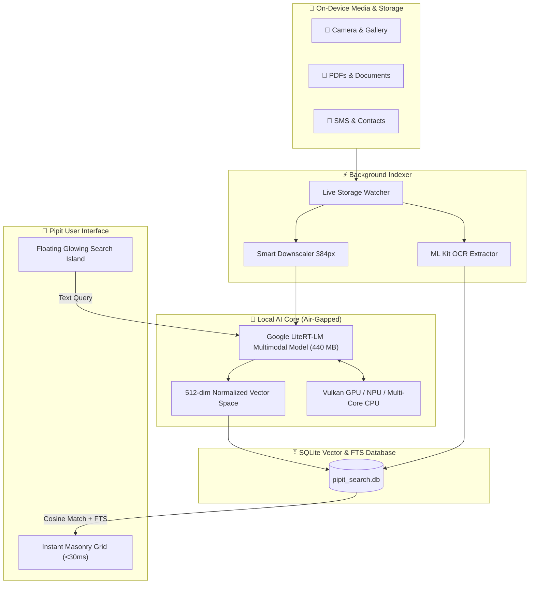

<div align="center">

  

  # 🐦 Pipit
  ### The On-Device AI Universal Search Engine for Android

  <p align="center">
    <b>Find anything on your device in under 50 milliseconds — without the cloud, without tracking, and 100% offline.</b>
  </p>

  <p align="center">
    <a href="#-quickstart"></a>
    <a href="#-tech-stack"></a>
    <a href="#-architecture"></a>
    <a href="#-privacy-manifesto"></a>
    <a href="LICENSE"></a>
  </p>

  <p align="center">
    <a href="#-why-pipit-vs-traditional-search">Why Pipit?</a> •
    <a href="#-core-features">Features</a> •
    <a href="#-search-showcase">Query Showcase</a> •
    <a href="#-architecture">Architecture</a> •
    <a href="#-quickstart">Quickstart</a> •
    <a href="#-privacy-manifesto">Privacy Manifesto</a> •
    <a href="#-roadmap">Roadmap</a>
  </p>

</div>

---

## 💡 The Problem with Smartphone Search Today

Smartphones hold our entire digital lives: thousands of photos, work PDFs, downloaded invoices, voice notes, gate codes in SMS, and installed apps. Yet, finding a specific item feels like digging through an unorganized attic:

* 🧩 **Siloed in 7 Different Apps**: Gallery for photos, Downloads for PDFs, WhatsApp for receipts, SMS for codes, Contacts for numbers. You waste minutes app-switching.
* 🏷️ **Cryptic File Names**: Your phone saves memories as `IMG_20240914_WA0024.jpg` and bills as `Scan_Doc_09.pdf`. Traditional search only matches file names — rendering 98% of your files unfindable.
* ☁️ **Cloud Privacy Invasion**: Big-tech photo search tools upload your private family albums and sensitive documents to remote servers to run AI models on their machines.
* 📶 **Fails Without Internet**: The moment you board a flight, go off-grid, or lose signal, cloud-dependent search engines completely stop working.

---

## ⚡ The Solution: Pipit

**Pipit** brings cutting-edge **multimodal neural AI directly onto your smartphone's silicon**. It indexes your device locally and understands **the semantic meaning** of what you are looking for — not just exact file names.

Search for *"yellow vintage car"*, *"handwritten grocery list"*, *"passport renewal invoice"*, or *"Wi-Fi router password"*, and Pipit surfaces the exact photo, document, or message in **under 50 milliseconds**.

---

## 📊 Why Pipit vs Traditional Search?

| Capability | 🐦 **Pipit** | ☁️ **Google Photos / Cloud** | 📱 **Stock Android / OEM Finder** |
| :--- | :---: | :---: | :---: |
| **Privacy Guarantee** | **100% On-Device (Air-gapped)** | ❌ Cloud Scraped & Processed | ⚠️ Varies / Metadata Shared |
| **Works Offline / Airplane Mode** | **Yes (Full AI capabilities)** | ❌ Broken / Severely Limited | ✔️ Basic filename only |
| **Semantic Visual Search** | **Yes (Google LiteRT-LM int4)** | ✔️ Yes (Cloud servers) | ❌ No |
| **Deep OCR Inside PDFs & Images** | **Yes (On-Device ML Kit)** | ⚠️ Cloud-only / Limited | ❌ No |
| **Universal Cross-Domain Search** | **7 Domains in 1 Search Bar** | ❌ Photos only | ⚠️ Disjointed results |
| **Query Latency** | **< 50 ms (Local GPU/NPU)** | 🐌 600 ms – 2.5 s (Network) | ⚡ Fast (Filename only) |
| **Data Retention** | **Zero Telemetry / No Tracking** | ❌ Targeted ad profiling | ⚠️ Analytics collected |
| **Price / Storage Fees** | **Free & Open Source** | 💸 Monthly Cloud Subscriptions | Free (Stock) |

---

## ✨ Core Features

### 🧠 On-Device Multimodal AI Engine
* Powered by **Google LiteRT-LM int4 Quantized Multimodal Embedder**.
* Generates 512-dimensional vector embeddings directly on device for images and text queries.
* Performs lightning-fast cosine similarity vector search across your gallery in single-digit milliseconds.

### 🔍 Universal Unified Search Bar
One single, floating search bar simultaneously scans across all 7 device domains:
* 📸 **Photos & Screenshots**: Scenery, objects, colors, pets, people, and visual context.
* 📄 **Documents**: PDF pages, Word docs, spreadsheets, slides, and text files.
* 💬 **SMS & Chat Logs**: Verification codes, addresses, instructions, and messages.
* 🎬 **Videos**: Video files, screen recordings, clips, and metadata.
* 🎵 **Audio & Music**: Voice recordings, audio notes, podcasts, and music tracks.
* 👤 **Contacts**: Names, nicknames, phone numbers, and organizations.
* 📱 **Installed Apps**: Instant app launcher matching names and categories.

### 📝 Deep Content Extraction (OCR)
* Integrated with on-device **Google ML Kit Text Recognition**.
* Extracts text from receipts, whiteboards, business cards, screenshots, and multi-page PDFs.
* Search for an order number or address, and Pipit will highlight the screenshot or PDF containing it.

### 🚀 Hardware Accelerated Inference
* **Automatic GPU / NPU Acceleration**: Automatically harnesses your device's Vulkan GPU delegate or NPU.
* **Intelligent Multi-Thread Fallback**: If GPU is occupied, seamlessly routes to 4–16 parallel CPU threads without dropping frames.
* **RAM Cache Optimization**: If the model is already in RAM, skips disk I/O completely for instant query execution.

### 🏝️ Floating Glowing Search Island
* Modern, ergonomic floating search bar positioned right at your thumb.
* Ambient **Pipit Teal (`#15786C`) glow** pulses dynamically when search completes.
* Quick-action chip suggestions for instantaneous query formulation.

### 🔄 Live Storage Watcher & Anti-Deletion Shield
* **Real-time File Watcher**: Automatically indexes new photos, downloaded PDFs, and screenshots in the background the moment they are saved.
* **Anti-Deletion Mirror Protection**: The AI model is mirrored in `/storage/emulated/0/Download/Pipit/models/` — ensuring that even if you uninstall or clear the app, your 440 MB downloaded model file is never lost!

### 🎨 Fully Customizable UI
* **Adaptive Grid Density**: Toggle between **2 Columns** (rich metadata), **3 Columns** (balanced view), or **4 Columns** (compact dense gallery).
* **Drag-to-Reorder Tabs**: Long-press and drag to prioritize your favorite categories (e.g., Photos first, or Documents first).
* **Granular Domain Controls**: Turn off SMS or Contacts search with one toggle in Settings if you prefer to keep them excluded.

---

## 🔍 Search Showcase

See how natural language searches map to real results in Pipit:

| What You Type | What Pipit Understands & Finds | Why Other Search Fails |
| :--- | :--- | :--- |
| `"sunset over the mountains"` | Photos containing orange/purple sky, mountain horizons, and nature vistas. | File is named `IMG_20230812.jpg` with zero text tags. |
| `"invoice total $420.50"` | Scanned PDF receipt or screenshot containing that exact line item. | Standard search only reads the PDF file title. |
| `"wifi password living room"` | Screenshot of router sticker or SMS sent by a friend. | Standard search cannot read text inside screenshots. |
| `"black cat sleeping on sofa"` | Specific pet photo matching the visual concept and color scheme. | No human manually tags every pet photo. |
| `"gate code 9042"` | SMS or note containing gate access code. | Buried under 3,000 unread messages in default SMS app. |
| `"quarterly budget spreadsheet"` | Financial Excel/PDF file modified in Q3. | Standard search requires exact file naming match. |

---

## 🏗️ Architecture

Pipit's pipeline is strictly local-first and air-gapped by design:



---

## 🛠️ Tech Stack

* **Framework**: [Flutter](https://flutter.dev) (v3.19+ / Dart 3.x)
* **AI & Machine Learning**: 
  * `flutter_edge_ai`: Google LiteRT-LM on-device runtime
  * `flutter_edge_ai_litertlm`: Multimodal quantized tensor execution
  * `google_mlkit_text_recognition`: Local OCR text extractor
* **Database & Indexing**:
  * `sqflite`: Vector embedding repository & Full-Text Search (FTS) index
* **Hardware & Storage**:
  * `path_provider` & Android Scoped MediaStore
  * Multi-stream parallel chunk downloader with SHA-256 validation
* **Design & Experience**:
  * Material Design 3 with custom dynamic lighting
  * Native haptics (`haptic_feedback` & `vibration`)
  * `go_router` for route handling

---

## 🚀 Quickstart

### Prerequisites
* [Flutter SDK](https://docs.flutter.dev/get-started/install) (`^3.19.0` or higher)
* Android SDK (API Level 26+ / Android 8.0 Oreo or higher)
* Physical Android Device (recommended to experience hardware GPU acceleration)

### 1. Clone & Install
```bash
git clone https://github.com/your-username/pipit.git
cd pipit
flutter pub get
```

### 2. Run on Device
```bash
flutter run
```

### 3. One-Tap Model Download
1. Launch **Pipit** on your phone.
2. Tap the **`✨ Setup AI`** badge in the top bar or tap **Download Model** on the home screen.
3. Tap **Start Download** — the high-speed 4-stream downloader will fetch the quantized 440 MB LiteRT vision model directly onto your device.
4. Once verified, the model automatically loads into RAM with GPU acceleration enabled.

---

## 🛡️ Privacy Manifesto

We believe your personal photos, files, and messages are nobody else's business:

1. **Air-Gapped by Design**: Pipit’s search pipeline has no remote API endpoints. Search queries never touch a network socket.
2. **Zero Telemetry**: No Google Analytics, no Mixpanel, no crashlytics harvesting user actions.
3. **No Account Required**: No logins, no passwords, no email verification. You install the app and it belongs entirely to you.
4. **Audit Friendly**: You can inspect network traffic using Wireshark, Charles Proxy, or Android Studio Network Profiler — Pipit produces **zero outbound packets** while searching.

---

## 🗺️ Roadmap

- [x] On-Device LiteRT-LM Multimodal Embedding Engine
- [x] GPU/NPU Hardware acceleration delegate
- [x] 7-in-1 Universal Cross-Domain Search
- [x] Deep OCR indexing for PDFs and screenshots
- [x] Multi-chunk parallel model downloader with pause/resume
- [x] Anti-deletion storage mirroring
- [x] Customizable grid densities (2, 3, 4 columns) and reorderable tabs
- [ ] **On-Device Audio Transcription**: Whisper-tiny integration for voice notes and lectures
- [ ] **Keyframe Video Indexing**: Semantic scene search across long video recordings
- [ ] **Visual Similarities & Face Clustering**: 100% offline cluster grouping
- [ ] **Cross-Platform Support**: iOS & macOS release (CoreML integration)

---

## 🤝 Contributing

We welcome contributions from developers, designers, and AI enthusiasts!

1. Fork the Project (`https://github.com/your-username/pipit/fork`)
2. Create your Feature Branch (`git checkout -b feature/EpicFeature`)
3. Commit your Changes (`git commit -m 'Add EpicFeature'`)
4. Push to the Branch (`git push origin feature/EpicFeature`)
5. Open a Pull Request

---

## 📄 License

Distributed under the **MIT License**. See [`LICENSE`](LICENSE) for more details.

<div align="center">
  <sub>Built with ❤️ for privacy, speed, and intelligence. Star ⭐ this repository if Pipit helped you find what you were looking for!</sub>
</div>
