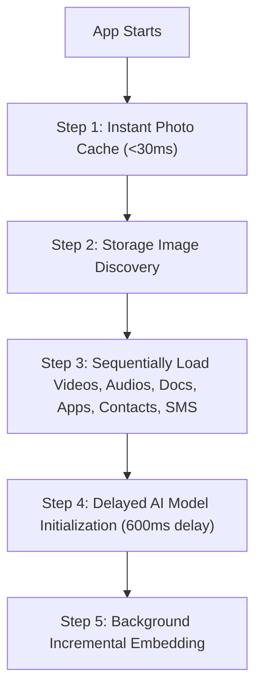
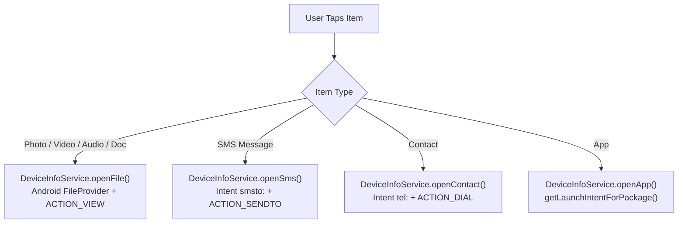

# Pipit Master Architecture, UI & Performance Reference

> **Purpose:** This reference document consolidates all historical analysis, architectural decisions, and performance optimizations from conversations `9162f313-f807-4740-b6be-069c1bc8be96` (*Optimizing Model RAM Caching And Performance*), `e175bebb-b666-4209-8e8c-6de5c42248f8` (*UI Refactoring and Performance Optimization*), and `f49af791-ab8e-4eed-b585-903fcb5d5e7d` (*Splash, Shimmer & Intent Integration*).  
> **Use this document to prevent repeated, time-wasting codebase analyses.**

---

## 1. Fast Reference & Service Directory

| Component / Service | File Path | Core Role & Optimization Rules |
| :--- | :--- | :--- |
| **HomeScreen** | `lib/screens/home/home_screen.dart` | Main hub; 8 tabs; staged cache loading; 3.0s default shimmer with extension; system intents on tap. |
| **SplashScreen** | `lib/screens/splash/splash_screen.dart` | 4.0s total splash (3400ms logo float + 600ms fluid wave sweep); continuous 14-40ms haptics; preview behind layer. |
| **DatabaseService** | `lib/services/database_service.dart` | SQLite cache; batch transactions; `getAllRecordsLightweight()` prevents BLOB RAM bloat on boot. |
| **AiService** | `lib/services/ai_service.dart` | Singleton ONNX/vector engine; delayed initialization (600ms); text embeddings for non-images (`embedAllByText`). |
| **BackgroundWorkerService** | `lib/services/background_worker_service.dart` | Parallel thumbnail extraction & text OCR; throttled concurrency to avoid UI frame drops. |
| **DeviceInfoService** | `lib/services/device_info_service.dart` | Platform channel bridge; opens native apps (`openFile`, `openApp`, `openSms`, `openContact`). |
| **LiveStorageWatcherService**| `lib/services/live_storage_watcher_service.dart` | Real-time file system observer; triggers instant database pruning when files are deleted on disk. |
| **DuplicateRemoverService** | `lib/services/duplicate_remover_service.dart` | Deduplicates media/records by SHA hash, normalized phone number, or path. |

---

## 2. Conversation 1: Model RAM Caching & Performance (`9162f313`)

### Problem
- The vision AI model was reloading into RAM repeatedly, causing cache and RAM bloat of **2GB to 10+ GB**.
- App boot time was extremely slow due to simultaneous database queries and disk scans.
- Searching and scanning froze the UI thread.

### Root Causes & Permanent Fixes
1. **Singleton AI Service with Delayed Init:**
   - `AiService` is strictly a singleton.
   - Never loads the heavy vision model on app boot. Startup loads instant photo cache first, and delays `AiService.instance.initialize()` by **600ms** until UI frames are completely idle.
2. **Text Embeddings vs Vision Model Separation:**
   - **Photos:** Embedded using vision model features.
   - **Videos, Audios, Documents:** Embedded using **lightweight text representations** (`embedAllByText` using `${item.name} ${item.location}`) instead of executing heavy video/audio neural decoders.
3. **Lightweight Database Queries (`getAllRecordsLightweight`):**
   - On boot, the app queries only metadata (`path`, `name`, `file_size`, `modified_timestamp`, `is_processed`), completely skipping heavy thumbnail bytes and float vector arrays until requested.
4. **Batch Transactions with Conflict Replacement:**
   - Media discovery uses `db.batch()` with `ConflictAlgorithm.replace`, reducing database I/O overhead by over 95%.

---

## 3. Conversation 2: UI Refactoring & Scan Elimination (`e175bebb`)

### Problem
- Full disk rescanning ran on every app launch and tab switch, wasting battery and freezing UI.
- UI had inconsistent card layouts between contacts, SMS, documents, and media.
- Cluttered top app bar with heavy loading indicators.
- Call logs were unnecessary and cluttered the experience.

### Architectural Decisions & Fixes
1. **Zero-Rescan Pattern (`forceRescan: false`):**
   - All loaders (`_loadAllDeviceDocuments`, `_loadAllDeviceVideos`, `_loadAllDeviceAudios`, etc.) accept `bool forceRescan = false`.
   - If SQLite records exist, they populate memory instantly and exit without touching the filesystem.
   - Storage scanning only triggers when the database is empty or user performs a pull-to-refresh (`forceRescan: true`).
2. **Removal of Call Logs:**
   - Removed `DeviceCallLog`, `CachedCallLogRecord`, `TimelineItemType.callLog`, phone permissions, and the Calls tab (reduced tabs from 9 to 8).
3. **Unified Card Design System:**
   - All tabs use square 1:1 aspect ratio cards with `23px` rounded corners and `grey.shade200` borders.
   - Distinct dedicated widgets: `_ImageCard`, `_VideoCard`, `_AudioCard`, `_DocumentCard`, `_AppCard`, `_ContactCard`, `_SmsCard`.
4. **Mini Pill Status Indicator:**
   - Status ticker replaced with a compact pill-shaped card on the app bar showing the category icon, active file count, and a micro circular loader.
5. **Real-time Deletion Sync:**
   - `LiveStorageWatcherService` listens for file changes. If a file is deleted from external storage, `_syncDeletedFiles()` deletes it from the SQLite database and removes it from the UI immediately.

---

## 4. Conversation 3: Native Intents, Splash & Shimmer (`f49af791`)

### Key Enhancements
1. **Direct System Intent Actions:**
   - Removed popups/dialogs when tapping items.
   - Media (photos, videos, audios, documents) opens in default system apps via `FileProvider` with `FLAG_GRANT_READ_URI_PERMISSION`.
   - SMS opens in the default system messaging app (`ACTION_SENDTO` with `smsto:`).
   - Contacts open in the default system phone dialer (`ACTION_DIAL` with `tel:`).
   - Apps launch immediately via `getLaunchIntentForPackage`.
2. **Universal Search Priority:**
   - App search results are pinned at the top of Universal Search results.
3. **Splash Screen Timing (4.0s Total):**
   - Logo draws and settles for `3400ms`.
   - Fast upward white wave sweep runs for `600ms`, finishing at exactly `4000ms`.
   - Continuous high-to-low silky micro-haptics (`14ms` interval scaling to `40ms`).
   - Behind layer mounts `HomeScreen(isSplashPreview: true)` so the user sees the bottom navigation island and shimmering grid as the wave rises.
4. **Home Screen 3-Second Default Shimmer with Dynamic Extension:**
   - Shimmer displays for **3.0 seconds by default**.
   - If loading takes longer, the shimmer **extends** until loading completes.
   - If data loads before 3.0s, the shimmer stays until the 3.0s threshold is reached.
   - If the user begins typing a search query, shimmer immediately yields to instant search results.
   - Shimmer card pulse duration sped up to `650ms`.
5. **Universal Empty-State Fallback:**
   - Prevents infinite shimmer traps across all 8 tabs when a device or category has 0 items. Once loading completes and the 3s default timer elapses, empty state cards with informative icons and action buttons appear instead of persistent shimmer grids.

---

## 5. Development Guardrails & Anti-Regression Rules

1. **Never load AI models synchronously on app start:**
   - Always keep `AiService.instance.initialize()` inside the delayed Step 4 of `_initApp()`.
2. **Never rescan storage without checking SQLite first:**
   - Always follow the `if (cachedItems.isNotEmpty && !forceRescan) return;` pattern.
3. **Never bypass FileProvider permissions on Android 7+ (API 24+):**
   - File sharing must use `FileProvider.getUriForFile` configured in `file_paths.xml` and `AndroidManifest.xml`.
4. **Never run terminal commands automatically:**
   - Always present shell commands in text format for the user to run manually.
5. **Always maintain the 8-tab structure:**
   - Tab 0: All / Timeline
   - Tab 1: Photos
   - Tab 2: Videos
   - Tab 3: Audios
   - Tab 4: Documents
   - Tab 5: Apps
   - Tab 6: Contacts
   - Tab 7: SMS
6. **Never unconditionally return shimmer on empty data:**
   - Always guard empty checks with `if (_isInitialLoading || _isLoadingX) return _buildSearchShimmerGrid();` so that completed empty states display clean fallback UI rather than permanent shimmer.

